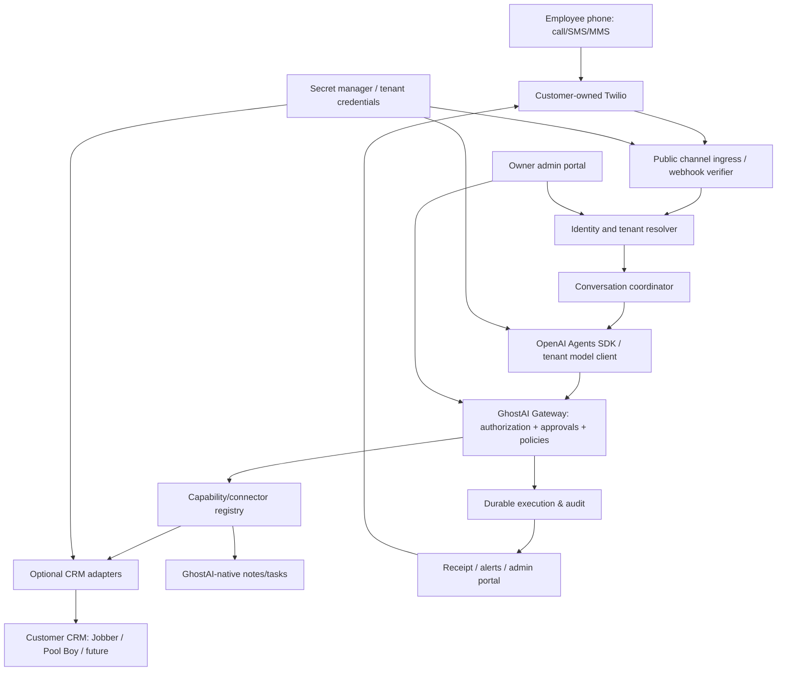

# Architecture — provider-neutral hosted AI operation layer

## System map

## Components and deployment boundaries
1. **Portal**: Next.js, TypeScript, passwordless/passkey or strong hosted auth, company invitations, consent, employee roles, connector setup, approvals, health and audit. Avoid duplicating CRM views.
2. **Channel ingress**: HTTPS Twilio webhooks (validate signatures with correct public URL, raw request/body semantics); use explicit Twilio account/number binding to resolve tenant, reject unknown numbers/accounts, deduplicate provider message SID/call events. Store media privately and validate types/sizes.
3. **Realtime voice service**: Long-lived WebSocket/media streaming endpoint; bridge Twilio audio to OpenAI Realtime or a well-tested speech pipeline. Session interruption/barge-in, turn detection, latency, reconnect, phone hangup, consent prompts and deterministic failure fallback. One authoritative agent session; no separate competing agents.
4. **Conversation/runtime**: OpenAI Agents SDK orchestration with one primary Executive and capability-scoped tools. The runtime does not choose tenant identity or permissions; those originate in authenticated ingress. Use one customer's restricted OpenAI API key per invocation, never a shared provider client with mutable credentials across tenants.
5. **Trusted Gateway**: Provider-agnostic operation registry, READ/ROUTINE/SENSITIVE/CRITICAL classes, JSON schema validation, tenant-aware access, limited concurrency, approval state, durable idempotency and verified result semantics.
6. **Connector registry**: Adapter manifests express capabilities and schemas; dynamic tool availability = connected provider + supported operation + caller role + current health. CRM stays authoritative for CRM records.
7. **Worker + queue**: Durable handling of outbound SMS, non-realtime work, retries, event processing, reconciliation and approval timeouts; per-tenant quotas and backpressure.
8. **Database + secret storage**: PostgreSQL organization/member/channel bindings/conversations/requests/receipts/audit; object storage for attachments; KMS-encrypted tenant credentials, never plain secrets in logs or model input.
9. **Monitoring**: Customer integration health and actionable notifications; staff-facing status, trace IDs, provider classification and no sensitive payload leakage.

## Request lifecycle
1. Verify provider signature and deduplicate inbound event; bind `tenant_id` via authenticated Twilio account/resource mapping, not AI text and not sender alone.
2. Resolve actor to `principal_id`, `identity_assurance`, role and allowed operations. Unknown: minimal public intake capabilities.
3. Store turn and route to organization's OpenAI project (restricted BYO key).
4. Agent proposes registered tool invocation: `tenant_id`, `principal_id`, `conversation_id`, `request_id`, `operation_id`, validated arguments.
5. Trusted Gateway validates tenant membership, actor, connector availability, risk class and approval policy; never trusts agent-supplied identity or tenant fields.
6. Persist idempotency key and execution state **before remote call**. For sensitive/critical work, wait for approval on exact normalized operation digest.
7. Invoke adapter and record provider IDs/status. Where supported, read back canonical resource and validate intended change.
8. Return `verified`, `accepted_unverified`, `pending`, `rejected` or `failed` with safe explanation and specific receipt. Unknown outcome triggers reconciliation, not automatic duplicate write.
9. Send SMS/speak result; preserve audit and health telemetry.

## Multi-tenant data design
Core records: `organizations`, `users`, `memberships`, `phone_identities`, `channel_connections`, `provider_connections`, `credentials_refs`, `conversations`, `messages`, `operation_definitions`, `operation_requests`, `approvals`, `provider_receipts`, `audit_events`, `usage_events`, `alerts`, `attachments`.
Every tenant-owned row uses `tenant_id`; enforce server-side predicates, database RLS where applicable, and strict authorization in worker queues, caches and object storage. Do not trust user-supplied tenant IDs. Unique keys include tenant + provider + webhook event ID, and tenant + idempotency key. Retain minimal message content with configurable retention and deletion/export paths.

## Technology proposal and tradeoffs
- **API / portal**: Next.js (Vercel optional). Long-lived Twilio Media Streams MUST use a WebSocket-capable service; ordinary stateless serverless API routes are not sufficient for live bidirectional media.
- **Agent Gateway / runtime**: Python service to reuse proven Robot Core contract logic and Agents SDK. A TypeScript-only rewrite is possible but must preserve behavior via contract tests first.
- **Persistence**: managed PostgreSQL plus secure blob store and KMS. Avoid local SQLite and process-local approval caches in a horizontally scaled service.
- **Operations**: background jobs with durable leases/outbox and dead-letter handling; provider retries only where idempotency is proven.
- **Deployment**: separate dev/staging/prod, health probes, tenant-scoped metrics, backups, runbooks and key rotation.

## Source-reference note
Adapt `WanderingInterest/robot-core/robot_core_gateway/` and `docs/migration/AGENT_GATEWAY_CONTRACT.md`; do not import robotics/hardware domains or copy desktop SQLite assumptions. `robot-core-personal` has separately useful Realtime/context patterns but a distinct custom inference runtime. No claim is made that GhostAI currently runs either source.
